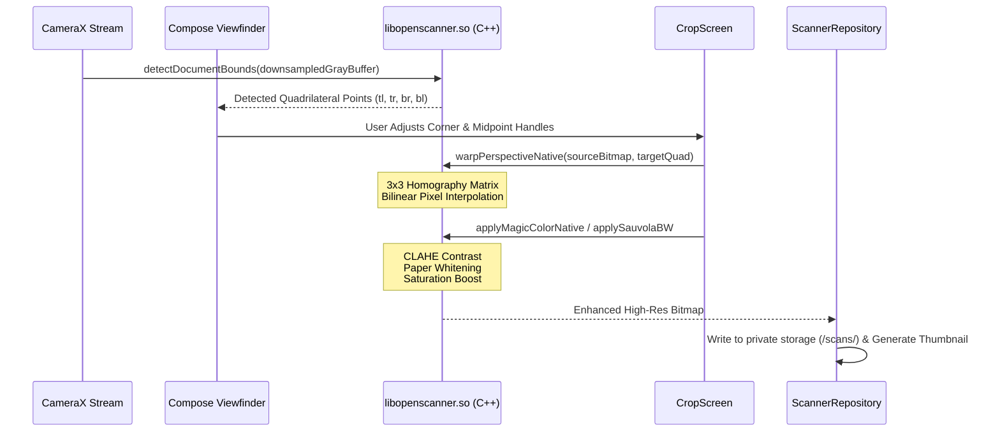

# OpenScanner — System Architecture & Modular Design (ARCHITECTURE.md)

## 1. Architectural Philosophy

OpenScanner adheres strictly to **Modern Android Architecture (MVVM)**, **Unidirectional Data Flow (UDF)**, and **Component-Driven Modular UI Design** (mirroring modern component tree architectures).

```
┌─────────────────────────────────────────────────────────────┐
│                    UI Layer (Jetpack Compose)               │
│  Modular Components • Stateless Screen Coordinators • Theme │
└──────────────────────────────▲──────────────────────────────┘
                               │ StateFlow Events & UI State
┌──────────────────────────────▼──────────────────────────────┐
│                       ViewModel Layer                       │
│      Coroutines (viewModelScope) • UI Business Logic        │
└──────────────────────────────▲──────────────────────────────┘
                               │ Repository Calls
┌──────────────────────────────▼──────────────────────────────┐
│                      Repository Layer                       │
│    ScannerRepository (Single Source of Truth & IO Scope)   │
└───────────────▲─────────────────────────────▲───────────────┘
                │ Room Queries                │ File IO & Bitmaps
┌───────────────▼──────────────┐ ┌────────────▼───────────────┐
│     Local SQLite Database    │ │    App Private Storage     │
│   (Room Entities & DAOs)     │ │ (scans/, thumbs/, exports/)│
└──────────────────────────────┘ └────────────────────────────┘
                ▲                             ▲
                └──────────────┬──────────────┘
                               │ Native JNI Calls
┌──────────────────────────────▼──────────────────────────────┐
│              Native C++ Engine (libopenscanner.so)          │
│    Sobel Detection • Homography Warp • Adaptive Filters     │
└─────────────────────────────────────────────────────────────┘
```

---

## 2. Directory & Package Structure

```
org.openscanner/
├── OpenScannerApp.kt                 # Application subclass initializing Room & ThemeManager
├── camera/                           # CameraX Analyzers & Viewfinder Helpers
│   └── DocumentAnalyzer.kt           # Real-time frame luminance & contour stream
├── cv/                               # Computer Vision Bridge & Math
│   ├── DocumentQuadrilateral.kt      # 4-point geometric model & sorting
│   ├── NativeScannerEngine.kt        # JNI Bridge bindings to C++
│   └── CollageGenerator.kt           # A4 canvas multi-page collage compositor
├── data/
│   ├── local/                        # Room Database, TypeConverters, and DAOs
│   │   ├── AppDatabase.kt            # Schema definitions & migrations
│   │   └── Daos.kt                   # DocumentDao, PageDao, FolderDao
│   ├── model/                        # Immutable Data Models & Entities
│   │   ├── Document.kt               # Document record entity
│   │   ├── Page.kt                   # Page record entity with crop coordinates
│   │   └── Folder.kt                 # Folder entity & FolderWithCount projection
│   └── repository/
│       └── ScannerRepository.kt      # Single source of truth abstracting DB & storage
├── ocr/                              # On-Device Machine Learning
│   └── TextRecognitionHelper.kt      # Google ML Kit offline text extraction
├── pdf/                              # Document Compilation
│   ├── PdfExportOptions.kt           # Page size, compression quality, security params
│   └── PdfGenerator.kt               # PDFBox Android AES-encrypted PDF engine
└── ui/                               # 100% Jetpack Compose Material 3 UI Layer
    ├── MainActivity.kt               # Edge-to-Edge root Activity & Navigation Host
    ├── navigation/                   # Screen Routes & NavGraph arguments
    ├── theme/                        # Design System & Color Tokens
    │   ├── Theme.kt                  # Dynamic ScannerColors, Light & AMOLED Dark Schemes
    │   └── ThemeManager.kt           # SharedPreferences theme mode state holder
    ├── home/                         # Home Dashboard & Folder System
    │   ├── HomeScreen.kt             # Lightweight Screen Coordinator (~330 lines)
    │   ├── HomeViewModel.kt          # Document list, sort, search, and batch state
    │   ├── components/               # Decoupled UI Components
    │   │   ├── HomeTopBar.kt         # Header with Avatar, Logo, Theme Switcher & Search
    │   │   ├── FolderSection.kt      # Folder Grid/List layout with "+ New Folder" action
    │   │   ├── FolderCards.kt        # ScannerFolderListItem & ScannerFolderGridCard
    │   │   ├── FolderGraphic.kt      # Compose Canvas Manila folder vector graphic
    │   │   ├── DocumentListItem.kt   # Document row with thumbnail & verified badge
    │   │   ├── DocumentGridCard.kt   # Document card with page counter badge
    │   │   ├── BatchSelectionBar.kt  # Multi-select action bottom bar (Move, PDF, Delete)
    │   │   ├── HomeBottomBar.kt      # Bottom tabs with emerald floating shutter FAB
    │   │   └── HomeToolsTab.kt       # Scanner Tools grid & Theme toggle card
    │   └── dialogs/                  # Focused Home Dialogs
    │       ├── CreateFolderDialog.kt # Folder creation dialog
    │       ├── RenameFolderDialog.kt # Folder rename dialog
    │       ├── RenameDocumentDialog.kt# Document title edit dialog
    │       └── MoveToFolderDialog.kt # Folder picker dialog
    ├── detail/                       # Multi-Page Document View & Studio
    │   ├── DocumentDetailScreen.kt   # Lightweight Screen Coordinator (~390 lines)
    │   ├── DocumentDetailViewModel.kt# Page list, collage generation, PDF export
    │   ├── components/               # Decoupled Detail Components
    │   │   ├── DetailTopBar.kt       # Document title, back arrow & PDF export action
    │   │   ├── DetailBottomBar.kt    # 5 standard actions: Add, Collage, Share, Edit PDF, More
    │   │   └── PageGridCard.kt       # 2-column page thumbnail card with "01", "02" badges
    │   └── dialogs/
    │       └── CollageStudioDialog.kt# 2-in-1, 4-in-1, 6-in-1 A4 layout selector
    ├── camera/                       # Live Viewfinder Screen & Laser Polygon Overlay
    │   ├── CameraScreen.kt
    │   └── ViewfinderOverlay.kt
    ├── crop/                         # 8-Point Crop Editor & Floating Magnifier Loupe
    │   ├── CropScreen.kt
    │   ├── DraggablePolygonOverlay.kt
    │   └── MagnifierLoupe.kt
    ├── filter/                       # Live Filter Previews & Tuning Sliders
    │   ├── FilterScreen.kt
    │   └── FilterViewModel.kt
    ├── viewer/                       # Fullscreen Pinch-to-Zoom Page & OCR Viewer
    ├── pdf/                          # PDF Export Settings Dialog
    │   └── PdfExportDialog.kt
    └── signature/                    # Transparent Ink E-Signature Dialog
        └── SignatureDialog.kt
```

---

## 3. High-Performance Native Pipeline (C++ NDK)

The compute-intensive computer vision pipeline is implemented in native C++ (`app/src/main/cpp/`) and accessed through JNI (`NativeScannerEngine.kt`):



---

## 4. Theme System & Window Insets Architecture

OpenScanner implements a decoupled dynamic theming system with zero startup flicker:

1. **Native Window Startup:** `themes.xml` sets `android:windowBackground` to a neutral dark shade (`#121212`), preventing any blinding white flash before Compose renders.
2. **Edge-to-Edge:** `MainActivity` calls `enableEdgeToEdge()` on initialization.
3. **Dynamic Bar Controllers:** `OpenScannerTheme` synchronizes `isAppearanceLightStatusBars` and `isAppearanceLightNavigationBars` with the active theme state via `WindowCompat.getInsetsController`.
4. **Semantic Tokens:** Composables read semantic colors via `ScannerTheme.colors` (`background`, `surface`, `cardBorder`, `textPrimary`, `textSecondary`, `primary`, etc.), seamlessly supporting both **AMOLED Dark** and **Paper Light** modes.
